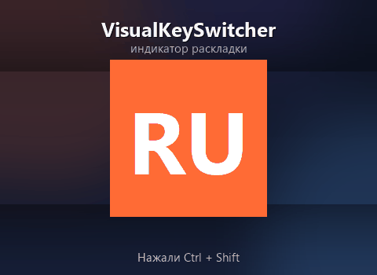
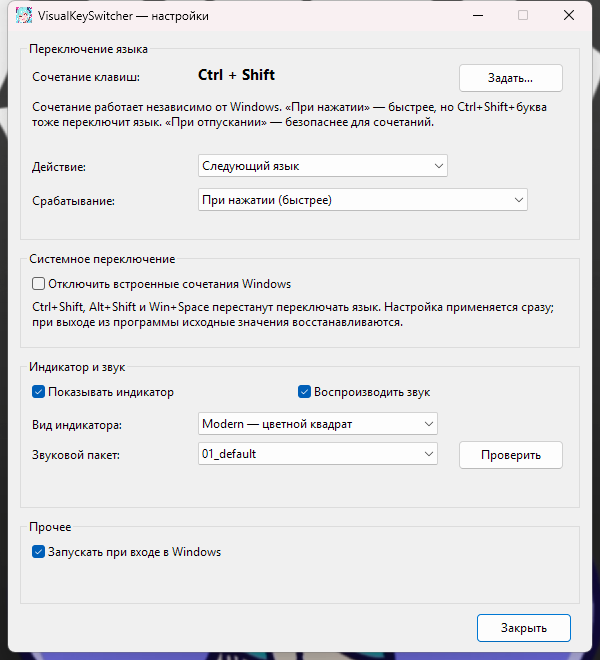

# VisualKeySwitcher

[Русский](README.md) | **English**

[](https://github.com/Doinkes/VisualKeySwitcher/actions/workflows/build.yml)

A tray utility that shows and voices keyboard layout changes on Windows 10/11 (x64).
It verifies that the layout actually changed and never shows a fake "success".

> The application UI is currently in Russian.

<p align="center">
  
</p>

## Download

**[GitHub Releases](https://github.com/Doinkes/VisualKeySwitcher/releases/latest)** —
download the zip, unpack it and run the exe.

Website: **[doinkes.github.io/VisualKeySwitcher](https://doinkes.github.io/VisualKeySwitcher/)**

## Features

- Any hotkey, including modifier-only chords (`Ctrl+Shift`, `Alt+Shift`, `Ctrl+Alt`).
- Trigger on press (faster) or on release (safer for letter combinations).
- The indicator appears instantly, without delays or animations.
- Three indicator styles: Classic, Modern, Squares. Positioned on the active
  monitor, with DPI and taskbar awareness.
- Sound packs: a separate sound for each language.
- Optionally disable the built-in Windows hotkeys so that only this program
  switches the layout. The original settings are restored on exit.
- Tray, autostart, settings, single instance.
- No internet access and no telemetry.

## Screenshots

<p align="center">
  
  
</p>

## Getting started

1. Put `VisualKeySwitcher.exe` and the `sound_pack` folder in the same directory.
2. Run the exe. No window opens — a tray icon appears.
3. Right-click the icon → “Настройки…” (Settings), or double-click it.

No installer is required. The exe is unsigned, so SmartScreen may warn on the
first launch.

## Settings

- **Hotkey** — click “Задать…” and press a combination. For a modifier-only
  chord you need at least two modifiers, for example `Ctrl+Shift`. `Esc` cancels.
- **Action** — next language, or a specific one (Russian/English).
- **Trigger** — on press or on release.
- **Indicator and sound** — enable/disable, choose a style and a sound pack.
  The “Проверить” (Test) button previews the indicator and the sound.
- **System hotkeys** — disables the native Windows shortcuts while the program
  is running.
- **Autostart** — start with Windows.

Settings are stored in `%APPDATA%\VisualKeySwitcher\config.ini`;
the log is in `%APPDATA%\VisualKeySwitcher\log.txt`.

### “On press” mode

The fastest option, but `Ctrl+Shift+letter` will also switch the language.
If that gets in the way, choose “on release”.

### System hotkeys

With blocking enabled, `Ctrl+Shift`, `Alt+Shift` and `Win+Space` no longer
switch the layout — VisualKeySwitcher does. Everything is restored when the
program exits.

With blocking disabled, the native Windows shortcuts keep working. Make sure
your hotkey does not match the system one, otherwise the layout may switch
twice. The program warns about this in the settings and in the tray.

## Sound packs

The `sound_pack` folder must be next to the exe:

```
sound_pack/
  01_default/
    ru.wav
    en.wav
  02_anime/
    ru.wav
    en.wav
  ...
```

The file name is the language code (`ru.wav`, `en.wav`, ...). If a language has
no file, `default.wav` is used. A new pack is just a new folder with WAV files.

## Command line

```
VisualKeySwitcher.exe --settings                 open settings
VisualKeySwitcher.exe --quit                     quit
VisualKeySwitcher.exe --test-switch              test switching
VisualKeySwitcher.exe --restore-system-hotkeys   restore system hotkeys
VisualKeySwitcher.exe --help
```

## Troubleshooting

- Windows running as administrator are invisible to the keyboard hook.
  Run VisualKeySwitcher as administrator too.
- Some games and applications reject the switch. In that case you will see the
  actual language with a red frame, and details in the log.
- If the program was killed while blocking was enabled, the system hotkeys may
  remain disabled. Run `VisualKeySwitcher.exe --restore-system-hotkeys`.
- The exe is unsigned; SmartScreen may warn on the first launch.
- Windows x64 is supported.

## Build

Rust (x64 MSVC) is required. From the project root:

```
scripts\build.bat
```

or:

```
cargo build --release
```

The exe appears in `target\release`; `scripts\build.bat` also updates
`Release\VisualKeySwitcher.exe` if that folder exists.

`Release` and `target` are local build folders and are not part of git.

## License

MIT — use, modify and redistribute, including commercially, as long as the
copyright notice and the license text are kept. See [LICENSE](LICENSE).

---

If the program is useful to you, please star the repository on GitHub.
It helps other people find it.
