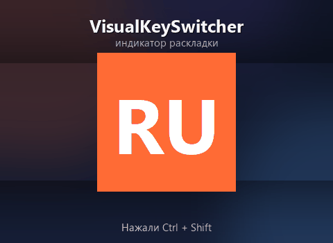
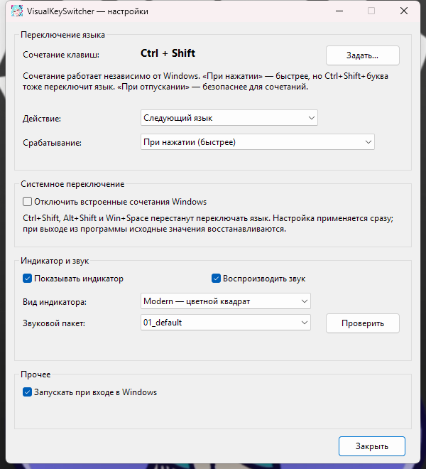

# VisualKeySwitcher

[English](README.en.md) | **Русский**

[](https://github.com/Doinkes/VisualKeySwitcher/actions/workflows/build.yml)

Индикатор и звуковое сопровождение при переключении раскладки клавиатуры.
Windows 10/11, x64.

## Что это

Небольшая программа для трея. Показывает, какой язык включён, и озвучивает
смену раскладки. Работает с вашим собственным сочетанием клавиш и не вводит
в заблуждение: если язык не сменился, вы увидите фактический язык и красную
рамку, а не «успешное» переключение.

<p align="center">
  
</p>

## Скачать

Готовая сборка: **[GitHub Releases](https://github.com/Doinkes/VisualKeySwitcher/releases/latest)**.
Скачайте архив из релиза, распакуйте и запустите exe.

Сайт: **[doinkes.github.io/VisualKeySwitcher](https://doinkes.github.io/VisualKeySwitcher/)**

## Возможности

- Любое сочетание клавиш, в том числе только из модификаторов
  (`Ctrl+Shift`, `Alt+Shift`, `Ctrl+Alt`).
- Срабатывание при нажатии (быстрее) или при отпускании (не мешает
  сочетаниям с буквами).
- Индикатор появляется сразу, без задержек и анимаций.
- Три вида индикатора: Classic, Modern, Squares. Позиция на мониторе
  активного окна, с учётом масштабирования и панели задач.
- Звуковые пакеты: свой звук для каждого языка.
- Можно отключить встроенные сочетания Windows, чтобы язык переключала
  только программа. После выхода настройки Windows возвращаются.
- Работа в трее, автозапуск, настройки, один экземпляр.
- Не требует интернета и не собирает телеметрию.

## Скриншоты

<p align="center">
  
  
</p>

## Запуск

1. Положите `VisualKeySwitcher.exe` и папку `sound_pack` в одну папку.
2. Запустите exe. Окно не откроется — появится иконка в трее.
3. Правый клик по иконке → «Настройки…» (или двойной клик).

Установка не требуется. Exe не подписан, поэтому SmartScreen может
предупредить при первом запуске.

## Настройки

- **Сочетание клавиш** — нажмите «Задать…» и введите комбинацию.
  Для сочетания только из модификаторов нужно минимум два, например
  `Ctrl+Shift`. `Esc` отменяет ввод.
- **Действие** — следующий язык или конкретный (русский/английский).
- **Срабатывание** — «при нажатии» или «при отпускании».
- **Индикатор и звук** — включить/выключить, выбрать вид и звуковой пакет.
  Кнопка «Проверить» показывает индикатор и проигрывает звук.
- **Системное переключение** — отключает родные сочетания Windows на время
  работы программы.
- **Автозапуск** — запускать при входе в Windows.

Настройки хранятся в `%APPDATA%\VisualKeySwitcher\config.ini`,
журнал — в `%APPDATA%\VisualKeySwitcher\log.txt`.

### Режим «при нажатии»

Самый быстрый, но `Ctrl+Shift+буква` тоже будет переключать язык.
Если это мешает — выберите «при отпускании».

### Системные сочетания

Если блокировка включена, `Ctrl+Shift`, `Alt+Shift` и `Win+Space` не
переключают язык — это делает VisualKeySwitcher. После выхода из программы
всё возвращается как было.

Если блокировка выключена, родные сочетания Windows работают. Следите, чтобы
ваше сочетание не совпадало с системным: иначе язык может переключиться
дважды. Программа предупредит об этом в настройках и в трее.

## Звуковые пакеты

Папка `sound_pack` должна лежать рядом с exe:

```
sound_pack/
  01_default/
    ru.wav
    en.wav
  02_anime/
    ru.wav
    en.wav
  ...
```

Имя файла — код языка (`ru.wav`, `en.wav`, ...). Если для языка файла нет,
используется `default.wav`. Новый пакет — просто новая папка с WAV-файлами.

## Командная строка

```
VisualKeySwitcher.exe --settings                 открыть настройки
VisualKeySwitcher.exe --quit                     закрыть
VisualKeySwitcher.exe --test-switch              проверить переключение
VisualKeySwitcher.exe --restore-system-hotkeys   вернуть системные сочетания
VisualKeySwitcher.exe --help
```

## Если что-то не работает

- В окнах, запущенных от администратора, программа не видит нажатия.
  Запустите её тоже от администратора.
- Некоторые игры и приложения не принимают переключение. Тогда появится
  фактический язык с красной рамкой, а подробности будут в журнале.
- Если программа была закрыта аварийно при включённой блокировке, системные
  сочетания могут остаться отключёнными. Запустите
  `VisualKeySwitcher.exe --restore-system-hotkeys`.
- Exe не подписан, SmartScreen может предупредить при первом запуске.
- Поддерживается Windows x64.

## Сборка

Нужен Rust (x64 MSVC). Из корня проекта:

```
scripts\build.bat
```

или:

```
cargo build --release
```

Готовый exe появится в `target\release`, а `scripts\build.bat` также
обновит `Release\VisualKeySwitcher.exe`, если эта папка есть.

`Release` и `target` — локальные папки сборки, в git они не входят.

## Лицензия

MIT — можно использовать, изменять и распространять, в том числе коммерчески,
при условии сохранения уведомления об авторстве и текста лицензии.
Подробнее — [LICENSE](LICENSE).

---

Если программа пригодилась — поставьте звезду на GitHub. Это помогает другим
её найти.
